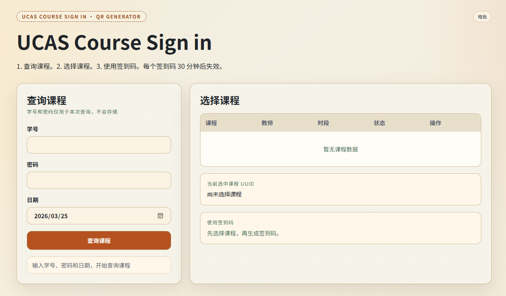
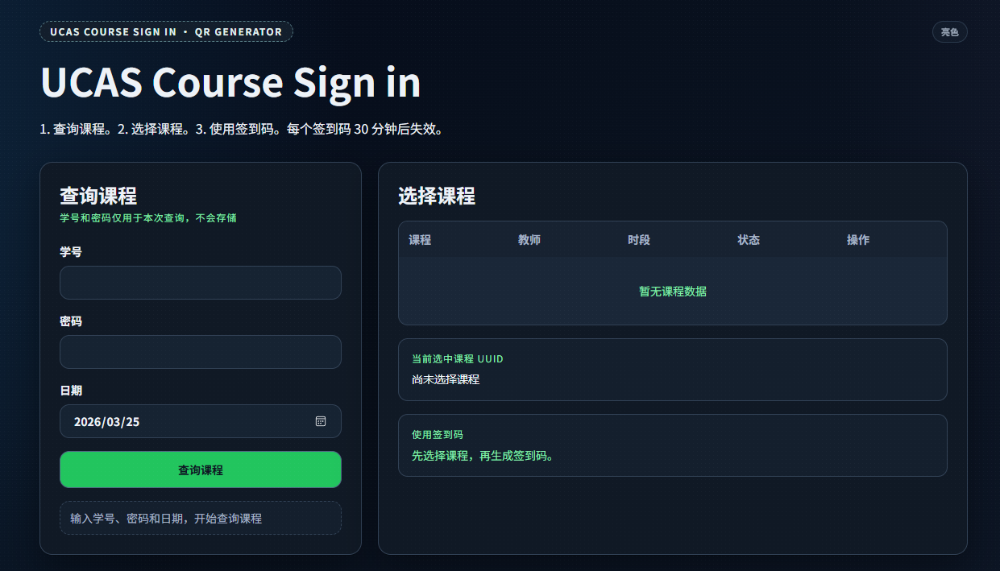

> [!IMPORTANT]
> **维护说明与贡献邀请**
>
> 本人已离开学校、返回研究所，无法继续在校验证课程查询与签到流程，也难以及时排查和修复学校上游接口变化带来的问题。因此，项目当前的功能可用性无法保证，部分问题可能暂时无法由本人修复。
>
> 欢迎有能力、具备在校测试环境的同学积极提交 [Pull Request](https://github.com/lccipher/UCAS-Course-Sign-in/pulls)，共同参与维护，协助适配上游接口、修复问题和完善文档。遇到问题也欢迎通过 [Issues](https://github.com/lccipher/UCAS-Course-Sign-in/issues) 提供复现步骤、错误信息和改进建议。感谢大家的理解与支持！

# UCAS Course Sign in

UCAS 课程查询与签到二维码生成工具。

在线访问：[自有域名](https://ucas-sign-in.pi3.fun/) · [Vercel 地址](https://ucas-sign-in.vercel.app/)

访问状态、免费额度和一键部署说明见下方[在线访问](#在线访问)章节。

>[!CAUTION]
> **本项目仅供学习交流使用，请勿用于任何商业用途或非法用途。**

本项目用于复现 XXXX 的课程查询与签到链路，帮助用户在网页端完成以下流程：

1. 输入学号、密码和日期，查询当天课程
2. 选择课程，生成可实时刷新的签到二维码
3. 在可签到时间内直接发起签到
4. 手动输入课程 ID 或 UUID，生成对应签到码

## 运行截图






## 快速开始

### 在线访问

- [自有域名：ucas-sign-in.pi3.fun](https://ucas-sign-in.pi3.fun/)
- [Vercel 地址：ucas-sign-in.vercel.app](https://ucas-sign-in.vercel.app/)

> [!NOTE]
> **访问状态更新（2026-10-22）**
>
> 网站已于 **2026 年 10 月 22 日恢复访问**。此前公共实例因 Edge Requests（现称 CDN Requests）超出 Vercel Hobby 免费额度，自 9 月 13 日起被平台暂停；本次已恢复现有项目访问，仍保留免费方案。
>
> **项目目前仍不稳定**：10 月 22 日手动测试时，有时能够签到成功，有时会出现接口异常或请求超时。网页恢复访问并不代表查询、校时和签到功能已完全恢复。异常的具体原因尚未确认，可能与学校上游接口或部署节点到学校的网络连通性有关；请以官方课堂系统中的实际签到记录为准。

#### Vercel 免费额度与公共实例限制

公共站点使用 Vercel 的 **Hobby 免费方案**，并非无限量服务。以下为 **2026-10-22 核对的主要额度**；额度和规则可能调整，请以 [Vercel Hobby 官方文档](https://vercel.com/docs/plans/hobby)及自己账号的 Usage 页面为准。

| 资源 | Hobby 免费额度 |
| --- | --- |
| CDN 请求数（CDN Requests，原 Edge Requests） | 100 万次 |
| 函数调用次数（Function Invocations） | 100 万次 |
| 对访客的数据传输（Fast Data Transfer） | 100 GB |
| 源站与 CDN 间的数据传输（Fast Origin Transfer） | 10 GB |
| 函数 CPU 执行时间（Active CPU） | 4 CPU 小时 |
| 函数预置内存用量（Provisioned Memory） | 360 GB·小时 |

上述主要用量按 **最近 30 天滚动窗口**统计，并非网站上线后的终身总量，也不是每月 1 日统一清零；同一 Hobby 团队内的项目共同消耗额度。可参阅 [Vercel 工作人员对统计周期的说明](https://community.vercel.com/t/account-paused/1383/3)。

- 两个在线地址指向同一个公共实例，**共享额度**，切换域名不会获得另一份免费额度。
- 页面、脚本、样式、图片和 API 请求都会消耗相应资源；**100 万次请求不等于 100 万次签到**。
- 超出免费额度或触发公平使用限制时，Vercel 可能暂停服务或阻止新部署；用量回落后也可能需要通过 [Vercel Support](https://vercel.com/help)申请解除限制。
- 请避免频繁刷新、反复重试或使用高频脚本请求公共实例，以减少上游和公共站点的负担。

#### 一键部署到自己的 Vercel 账号

欢迎有能力的同学将项目部署到自己的账号中，供个人使用和测试，减少对公共实例的依赖。点击下面的官方按钮即可进入 Vercel 部署向导：

[](https://vercel.com/new/clone?repository-url=https%3A%2F%2Fgithub.com%2Flccipher%2FUCAS-Course-Sign-in)

1. 登录 Vercel，选择自己的个人 Hobby 免费团队，并按提示连接 GitHub 等 Git 账号。
2. 部署向导会将本项目复制到你选择的 Git 账号中，并创建你自己的 Vercel 项目。
3. Framework 选择 **Next.js**，Build Command 使用默认的 `npm run build`，其余配置通常保持默认即可。
4. 按提示完成部署后，使用分配给你的域名访问。

自己的部署仍受对应账号的免费额度和 [Hobby 个人、非商业使用规则](https://vercel.com/docs/plans/hobby)限制。**自行部署不能保证解决学校上游接口异常或超时**，实际可用性仍需自行测试。按钮的工作方式可参阅 [Vercel Deploy Button 官方说明](https://vercel.com/docs/deploy-button)。

### 本地运行

1. 克隆仓库并安装依赖

```bash
git clone https://github.com/lccipher/UCAS-Course-Sign-in
cd UCAS-Course-Sign-in
npm install
```

2. 启动开发环境

```bash
npm run dev
```

默认访问地址：`http://localhost:3000`

3. 生产构建与启动

```bash
npm run build
npm run start
```

4. 代码检查

```bash
npm run lint
```

### 部署上线（可选）

推荐使用 Vercel 进行部署，步骤如下：

1. Fork 本仓库到你的 GitHub 账号
2. 在 Vercel 导入项目
3. Framework 自动识别为 Next.js
4. Build Command 使用默认的 `npm run build`
5. 部署完成后访问生成的域名

## 工作流程

```text
Browser
	-> POST /api/course-uuid/query
		-> login.action (上游登录)
		-> get_stu_course_sched.action (上游课表)
	<- 返回课程列表（已脱敏整理）
Browser
	-> 选择课程 / 手动输入课程 ID 或 UUID
	-> 本地生成签到 URL + QR Code
	-> POST /api/course-uuid/sign（可选，直接签到）
```

说明：

- 上游 `sessionId` 只在服务端请求链路中短暂使用，不回传前端。
- 前端二维码和下载二维码都由本地生成，不依赖额外前端存储。
- 直接签到时，服务端会先登录，再调用上游签到接口。

## 项目结构

```text
.
├─ src/
│  └─ app/
│     ├─ api/
│     │  └─ course-uuid/
│     │     ├─ query/
│     │     │  └─ route.ts      # 登录 + 课表查询接口
│     │     └─ sign/
│     │        └─ route.ts      # 登录 + 直接签到接口
│     ├─ globals.css            # 全局样式与主题变量
│     ├─ layout.tsx             # 字体、元信息、主题初始化
│     └─ page.tsx               # 主页面（查询、列表、二维码、签到）
├─ public/
├─ doc/
├─ package.json
└─ README.md
```

## API 说明

### POST /api/course-uuid/query

查询课程列表。

请求头：

- `Content-Type: application/json`

请求体：

```json
{
	"username": "2025xxxxxxxxxx",
	"password": "your-password",
	"date": "20260325"
}
```

字段说明：

- `username`：学号，必填
- `password`：密码，必填
- `date`：查询日期，支持 `yyyyMMdd` 或 `yyyy-MM-dd`

成功响应示例：

```json
{
	"date": "20260325",
	"total": 2,
	"courses": [
		{
			"id": "114xxxx",
			"uuid": "CADD27F17ACC44EDAFxxxxxxxxxxxxxx",
			"courseName": "xxxxxxx",
			"teacherName": "xxx",
			"weekDay": "周三",
			"classBeginTime": "2026-03-25 10:25:00",
			"classEndTime": "2026-03-25 12:00:00",
			"signStatus": "1"
		}
	]
}
```

常见错误响应：

```json
{
	"message": "登录接口请求超时",
	"code": "UPSTREAM_LOGIN_TIMEOUT"
}
```

### POST /api/course-uuid/sign

发起直接签到。

请求头：

- `Content-Type: application/json`

请求体：

```json
{
	"username": "2025xxxxxxxxxx",
	"password": "your-password",
	"timeTableId": "CADD27F17ACC44EDAFxxxxxxxxxxxxxx"
}
```

字段说明：

- `username`：学号，必填
- `password`：密码，必填
- `timeTableId`：课程 UUID，必填，必须是 32 位十六进制字符串

成功响应示例：

```json
{
	"success": true,
	"message": "签到成功",
	"upstreamStatus": "0",
	"result": {
		"stuSignId": "123456",
		"stuSignStatus": "1"
	}
}
```

可能的失败响应：

```json
{
	"success": false,
	"message": "签到失败，请稍后重试",
	"upstreamStatus": "1",
	"result": {
		"stuSignId": "123456",
		"stuSignStatus": "0"
	}
}
```

## 错误码与排查

### HTTP 状态码

- `400`：请求体或参数格式错误
- `401`：登录失败（账号密码错误或上游鉴权失败）
- `403`：非同源请求
- `409`：签到请求已提交，但状态未完成
- `415`：Content-Type 不是 JSON
- `429`：触发限流
- `502`：上游接口异常或返回异常
- `504`：上游接口超时
- `500`：服务内部异常

### 常见 `code`

- `RATE_LIMITED`
- `UPSTREAM_LOGIN_HTTP`
- `UPSTREAM_LOGIN_BAD_JSON`
- `UPSTREAM_LOGIN_TIMEOUT`
- `UPSTREAM_LOGIN_NETWORK`
- `UPSTREAM_SCHEDULE_HTTP`
- `UPSTREAM_SCHEDULE_BAD_JSON`
- `UPSTREAM_SCHEDULE_TIMEOUT`
- `UPSTREAM_SCHEDULE_NETWORK`
- `UPSTREAM_SIGN_HTTP`
- `UPSTREAM_SIGN_BAD_JSON`
- `UPSTREAM_SIGN_TIMEOUT`
- `UPSTREAM_SIGN_NETWORK`
- `UNEXPECTED_ERROR`

## 技术栈

### 前端

- Next.js 16.2.1（App Router）
- React 19.2.4
- TypeScript 5
- Tailwind CSS 4
- next/font（Noto Sans SC / Noto Serif SC / IBM Plex Mono）

### 服务端

- Next.js Route Handler（Node.js runtime）
- 原生 Fetch + AbortController 超时控制
- 内存级限流（5 分钟窗口 + 每日上限）

### 工具链

- ESLint 9 + eslint-config-next
- qrcode 1.5.4（前端二维码生成）

## License

[AGPL-3.0 License](./LICENSE)
